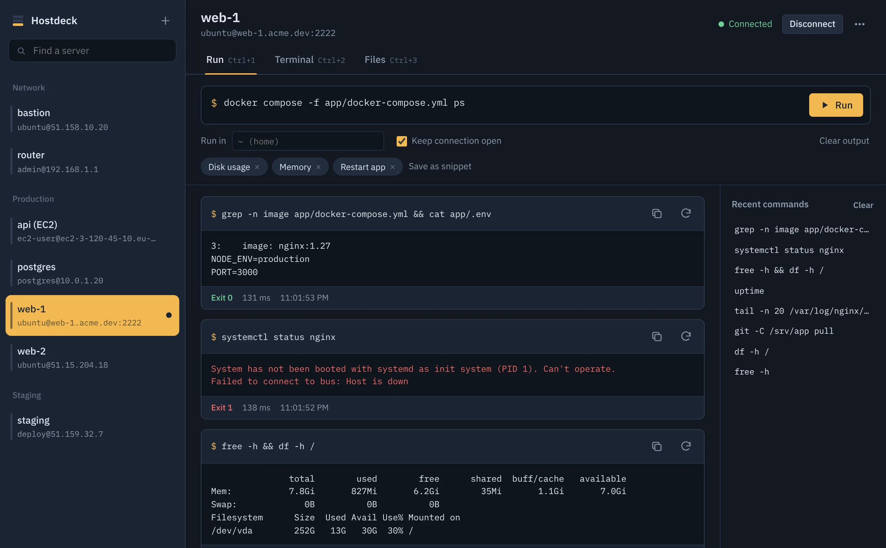

# Hostdeck

A local-first SSH server manager for Linux, Windows and macOS.

Save your servers once, then pick one, type a command and hit **Run**. Keep the connection open for longer sessions, open a full terminal, browse, search, upload and edit files over SFTP, or open web tools that only the server can reach. Everything stays on your computer: no account, no cloud sync, no telemetry.



**[Download](https://github.com/ramiatoui/hostdeck/releases/latest)** · **[Website](https://ramiatoui.com/hostdeck/)** · **[Documentation](https://ramiatoui.com/hostdeck/docs/)**

## Features

- **Run** commands and see live output, errors, exit code and duration. Per-server history, snippets, a working folder, and a confirmation before destructive commands.
- **Server health** in the header while connected: disk, memory, load and uptime, refreshed every 30 seconds.
- **Terminal**: a full interactive shell (xterm.js) for vim, htop and long sessions.
- **Browser**: open web pages through the server's SSH connection, so `localhost:8080` is the server's localhost. Admin tools kept off the internet (phpMyAdmin, pgAdmin, dashboards) open directly; listening ports are suggested.
- **Files**: SFTP browser with drag-and-drop upload, folder download, rename, permissions, delete, search in the folder or all subfolders, and an editor with syntax highlighting that won't overwrite changes made on the server without asking.
- **Every common login**: password (saved encrypted or asked each time), private key file or pasted key with passphrase, SSH agent / Pageant, keyboard-interactive 2FA, jump hosts, and legacy algorithms for old devices.
- **Host key verification**: trust on first use, with a clear warning if a key changes.
- **Import** hosts from `~/.ssh/config`, and export your server list (without secrets) to another computer.

## Where your data lives

One JSON file in your user folder (`~/.config/Hostdeck` on Linux, `~/Library/Application Support/Hostdeck` on macOS, `%APPDATA%\Hostdeck` on Windows). Passwords, pasted keys and passphrases are encrypted with the OS keychain (macOS Keychain, Windows DPAPI, Linux secret service). Key files are referenced by path, never copied.

## Development

Requires Node.js 20+.

```sh
npm install
npm start          # build the UI and launch the app
npm test           # tests run against an in-process SSH server
npm run dist:linux # or dist:win / dist:mac; output in release/
```

Project layout:

| Path | Contents |
| --- | --- |
| `src/main/ssh.js` | SSH engine: connections, auth, jump hosts, host keys, exec, shells, SFTP |
| `src/main/store.js` | Local store and secret encryption |
| `src/main/main.js` | Electron main process and IPC |
| `src/preload.js` | The narrow bridge exposed to the UI |
| `src/renderer/` | UI (plain DOM, xterm.js, CodeMirror) |
| `test/` | Tests and the test SSH server |
| `site/` | Static website and documentation |

## Releases

Open **Actions → Release → Run workflow** (it tags `v` + the version in `package.json`), or push a version tag such as `v0.1.0`. GitHub Actions then builds AppImage and .deb (x64, arm64), a Windows installer and portable .exe, and a universal macOS .dmg and .zip, then publishes them with checksums as a GitHub release. Builds are not code-signed yet.

## Website

`site/` is a plain static site (no build step) with the landing page and the docs. All links inside it are relative, so it can be served from any sub-path.

## License

MIT © Rami Atoui
